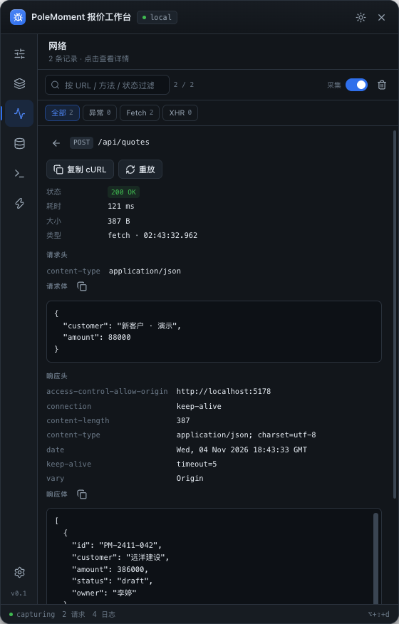

# Rinova Devtools

框架无关的前端调试面板。一行接入，提供环境配置、网络、存储、日志与快捷操作，并允许业务用插件扩展自己的调试能力。

- 内核只依赖 DOM，**Vue / React / Svelte / 原生页面同一套能力**
- UI 运行在 Shadow DOM，宿主样式与组件库互不污染
- 深色 / 浅色主题，右侧 / 左侧 / 底部停靠，悬浮球可拖拽吸附
- 网络面板支持复制 cURL、重放请求；配置面板 schema 驱动、即时生效
- 内置面板与业务插件同构，新增一个面板 ≤ 40 行



## 安装

```bash
pnpm add @rinova/devtools
# Vue 3
pnpm add @rinova/devtools-vue
```

> v0.1 尚未发布到 npm；当前通过 workspace 使用。

## 快速开始

```ts
import { createDevtools } from '@rinova/devtools'

createDevtools({
  appName: 'My App',
  enabled: import.meta.env.DEV,
  theme: 'auto',
  storagePrefix: 'my-app-devtools',
  config: [
    {
      key: 'gateway',
      type: 'select',
      label: '网关',
      allowCustom: true,
      options: [
        { label: '本地', value: 'http://localhost:8080' },
        { label: '测试', value: 'https://test.example.com' }
      ]
    },
    { key: 'token', type: 'text', label: 'TOKEN', copyable: true, mono: true },
    { key: 'abDebug', type: 'switch', label: 'AB 调试' }
  ],
  onConfigChange: ({ changed, values }) => {
    console.info('[devtools]', changed, values[changed])
  }
}).mount()
```

Vue 3：

```ts
import { createVueDevtools } from '@rinova/devtools-vue'

app.use(createVueDevtools({ appName: 'My App', config: [...] }))
```

```ts
const { values, open } = useDevtools()
```

快捷键 `alt+shift+d`，或点击右下角悬浮球。

## 包

| 包 | 说明 |
| --- | --- |
| `packages/core` → `@rinova/devtools` | 框架无关内核：Shell、配置、网络、日志、内置面板、插件系统 |
| `packages/vue` → `@rinova/devtools-vue` | Vue 3 插件、`useDevtools()`、`<RinovaDevtools>` 组件 |
| `examples/playground` | Vue 3 演示（`/`）与纯 DOM 演示（`/vanilla.html`） |

## 本地开发

```bash
pnpm install
pnpm dev          # http://localhost:5178
pnpm typecheck
pnpm test         # core 117 + vue 5
pnpm test:coverage
pnpm test:isolation
pnpm build
pnpm verify       # typecheck + test + build
```

要求 Node ≥ 22.12，pnpm 12。

## 文档

从 [docs/README.md](./docs/README.md) 开始：

- [产品定义](./docs/01-产品定义.md)
- [架构设计](./docs/02-架构设计.md)
- [配置与状态](./docs/03-配置与状态.md)
- [插件开发](./docs/04-插件开发.md)
- [框架接入](./docs/05-框架接入.md)
- [内置面板](./docs/06-内置面板.md)
- [决策与路线图](./docs/07-决策与路线图.md)
- [测试计划与用例](./docs/08-测试计划与用例.md)

## 技术栈

TypeScript 5.9 · Vite 8（lib 模式）· Less 4.9 · lucide 1.68 · Vue 3.5（仅适配器与示例）· Vitest 5

无 UI 组件库、无 CSS 框架、无远程资源、无遥测。

## 许可

MIT
