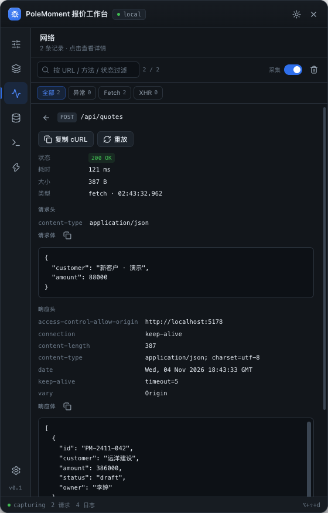
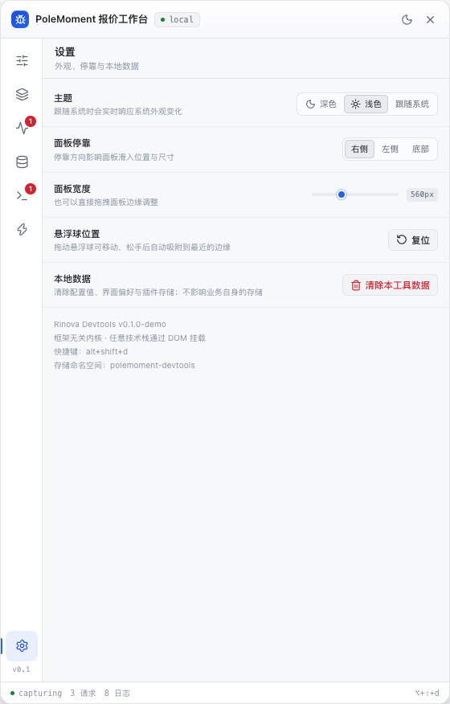
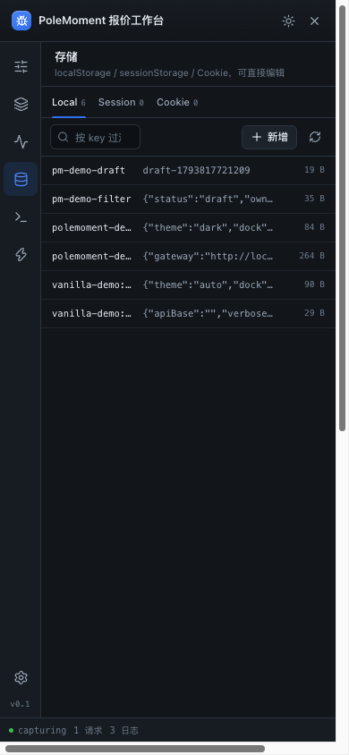

# 06 内置面板

内置面板是六个第一方插件，与业务插件同构；可通过 `builtinPlugins` 只保留需要的那几个。

```ts
createDevtools({ builtinPlugins: ['config', 'network'] }) // 数组 = 白名单
createDevtools({ builtinPlugins: false })                 // 全部关闭
```

## 1. 配置（config）

- 按 `groups` 顺序渲染字段；未声明的分组追加在末尾。
- 所有修改**即时生效**并写入 localStorage，没有"保存"按钮。
- 底部提供"恢复默认"。
- `select + allowCustom` 渲染为输入框 + 预设菜单，支持任意自定义地址。
- `text + copyable` 渲染为只读输入 + 复制按钮，适合 token、灰度号。

## 2. 网络（network）

**采集**

- 在 `mount()` 时补丁 `window.fetch` 与 `XMLHttpRequest`，面板未打开也持续记录。
- 记录：方法、URL、状态码、状态文案、耗时、请求头、请求体、响应头、响应体、大小。
- 响应体仅采集文本类型（json / text / xml / javascript / html / form），单条上限 200KB；二进制只记录大小。
- 流式响应（SSE）读取 clone 时最多等待 4 秒，拿不到内容会留空，不影响业务请求。
- XHR 无法读取请求头（浏览器不暴露），请求体为序列化后的字符串。

**列表**

- 搜索：URL / 方法 / 状态码。
- 过滤：全部 / 异常 / Fetch / XHR；异常 = 请求失败、非 2xx/3xx 或网络错误。
- 每行：方法、状态、路径（跨域时带 host）、耗时。
- 顶部开关可暂停采集，暂停期间请求不被记录（但也不会被阻塞）。

**详情**

- 状态、耗时、大小、类型、开始时间。
- 请求头 / 响应头键值表；请求体 / 响应体 JSON 自动格式化。
- 操作：`复制 cURL`（可直接粘到终端）、`重放`（相同 method / headers / body 重新发一次 fetch）、`复制响应体`。

**已知限制**

- 只记录 `mount()` 之后的请求。
- 不记录 `EventSource`、WebSocket、`sendBeacon`。
- 重放走 `fetch`，原请求若依赖 XHR 特有行为（上传进度等）不等价。
- 不提供请求改写 / Mock / 断点。

## 3. 存储（storage）

- 三个页签：Local / Session / Cookie，实时统计数量。
- 搜索 key；点击一行打开编辑器。
- Local / Session：修改值、新增 key、删除 key；写入失败（配额）会提示。
- Cookie：只读展示与删除（`path=/` 与当前路径各尝试一次）。**HttpOnly Cookie 不可见**，属浏览器限制。
- 切回本面板时会重新读取一次，能拿到业务刚写入的数据；不会监听同页后续写入（避免频繁重排）。

## 4. 日志（console）

- 补丁 `console.log / info / warn / error / debug`，保留原始输出。
- 同时捕获 `window.onerror` 与 `unhandledrejection`，计为 error。
- 过滤：全部 / 信息（log + info）/ 警告 / 错误；支持全文搜索。
- 同一级别 + 相同内容在 1.2 秒内重复出现会合并为计数，避免循环日志刷屏。
- 双击一行复制该条日志；右上角可复制当前筛选结果、清空。
- 对象按 JSON 预览（处理循环引用、函数、BigInt），单条最长 600 字符。

## 5. 快捷操作（actions）

- 展示 `actions` 选项与 `registerAction()` 注册的动作。
- 卡片整体可点击，右侧也有执行按钮；`Enter / Space` 可触发。
- `tone: 'danger'` 使用红色图标；`confirm` 启用两段式确认（第一次点击变成"确认执行？"，2.6 秒后复原）。
- 动作异常会被捕获并 toast，不会中断面板。

## 6. 设置（settings）

| 项 | 行为 |
| --- | --- |
| 主题 | 深色 / 浅色 / 跟随系统，持久化；跟随系统时监听系统切换 |
| 面板停靠 | 右侧 / 左侧 / 底部，持久化 |
| 面板宽度 | 380–900px 滑块，也可直接拖拽面板内边缘；持久化 |
| 悬浮球位置 | 复位到右下角 |
| 本地数据 | 清除本命名空间下的配置、界面偏好、插件存储；两段式确认 |
| 关于 | 版本、接入方式、快捷键、存储命名空间 |

## 7. 交互约定

- 悬浮球：单击开关面板；拖拽移动，松手后靠近边缘会吸附；位置持久化。
- 快捷键：默认 `alt+shift+d`；`Esc` 关闭面板。
- 面板内所有控件可键盘操作；但未实现完整焦点陷阱（面板不是 modal，不锁定页面滚动）。
- 窄屏（< 720px）：面板全屏，隐藏 resize 手柄。
- 面板打开时悬浮球淡出，避免遮挡关闭按钮。

## 8. 视觉规范

- 深色为默认（调试工具语境），浅色完整可用。
- 强调色 `--rdt-accent: #2f6feb`，与 rinova 产品线一致。
- 字体：系统 UI 字体；数据区（URL、headers、代码、日志）使用等宽字体。
- 动效：面板滑入 260ms，悬浮球 160ms，toast 180ms；`prefers-reduced-motion` 下全部降级。
- 信息密度优先：列表行 30px，日志行 22–30px，标题 13px，正文 11.5px。

## 9. 截图

深色 · 网络详情：



浅色 · 设置：



窄屏 · 全屏抽屉：


